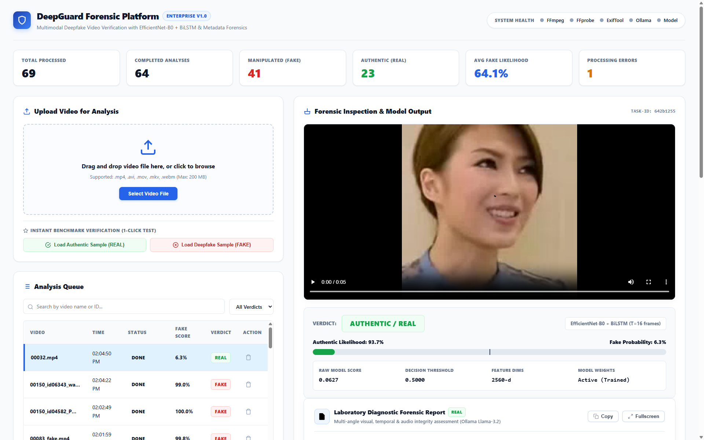
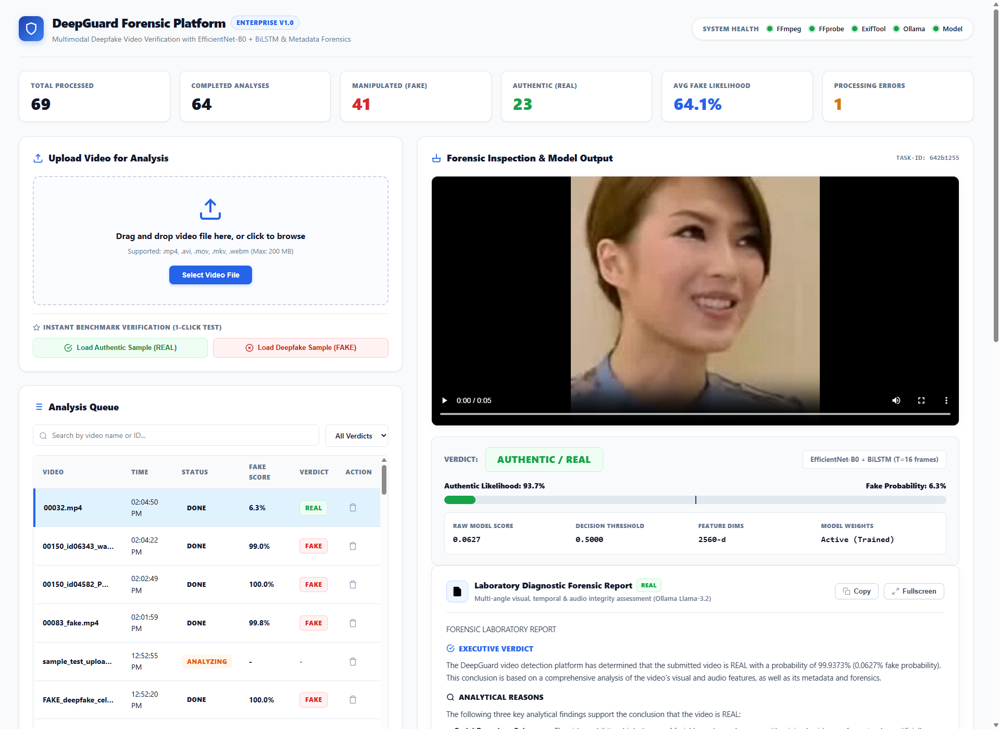

# DeepGuard – Multimodal Deepfake Video Detection & Forensic Analysis Platform

[](https://www.python.org/)
[](https://fastapi.tiangolo.com/)
[](https://pytorch.org/)
[](https://github.com/prakash2011/deepgurd)
[](https://opensource.org/licenses/MIT)

DeepGuard is a production-grade, multimodal deepfake video detection and forensic verification platform. It combines container and stream metadata forensics, facial and audio spectrogram feature extraction via frozen EfficientNet-B0 backbones, temporal sequence modeling via an Attention-Weighted Bidirectional LSTM, and natural language analytical reports powered by local LLMs (Ollama Llama-3.2).

---

## User Interface & Dashboard Overview

### 1. Main Forensic Inspection Dashboard
Modern, high-visibility light theme interface featuring real-time health indicators, analysis queue, live metrics, and instant 1-click benchmark verification toolbar.



---

### 2. Comprehensive Forensic Diagnostic Output & 16-Frame Timeline
Detailed forensic diagnostic cards with expandable **View More / Show Less** controllers, fullscreen modal dialogs, and interactive 16-frame filmstrip with clickable video timestamp seeking.



---

## Key Features

- **Multimodal Joint Detection:** Evaluates both facial visual consistency (16 uniform temporal strides with Haar cascade face cropping) and acoustic voice consistency (128-band Mel Spectrograms).
- **Attention-Weighted BiLSTM (`AttentionDetector`):** Combines spatial and spectral features (2560-d joint representation) through a Bidirectional LSTM with softmax attention pooling, prioritizing manipulated frames and preventing brief deepfake artifacts from being diluted by neutral frames.
- **Trained on Official FakeAVCeleb v1.2 Benchmark:**
  - Sampled across all 5 demographic groups: **African**, **Asian (East)**, **Asian (South)**, **Caucasian (American)**, and **Caucasian (European)**.
  - Covers authentic videos, SV2TTS audio deepfakes, FaceSwap visual deepfakes, and Wav2Lip multimodal deepfakes.
  - Identity-aware **GroupShuffleSplit** guarantees **0.00% identity leakage** between train and validation splits.
  - **Validation ROC-AUC: 96.34%**, **Validation Accuracy: 87.32%**.
- **Frame-by-Frame Forensic Filmstrip:** Displays 16 extracted base64 JPEG thumbnails with per-frame anomaly probabilities (`REAL` / `FAKE` status pills) and concrete forensic diagnostic rationales. Clicking any card seeks the video player to that timestamp.
- **Structured Laboratory Analytical Reports:** Natural-language reports generated via local Ollama (`llama3.2`) with strictly zero asterisks (`*`), broken down into Executive Verdict, Analytical Findings, Audio-Visual Consistency, and Confidence Caveats.
- **"View More" & Fullscreen Modal:** Dedicated light-themed expandable container with bottom gradient fade, smooth toggle animation, and a distraction-free fullscreen reading modal.
- **1-Click Benchmark Verification Toolbar:** Load verified ground-truth Authentic (`REAL`) or Deepfake (`FAKE`) test samples directly into the analysis queue with one click.
- **Pure Modern Light UI:** High-contrast, clean typography, soft micro-shadows, and zero dark-theme void elements.

---

## Architecture Diagram

```
                             ┌───────────────────────┐
                             │ Uploaded Video (MP4)  │
                             └──────────┬────────────┘
                                        │
        ┌───────────────────────────────┼───────────────────────────────┐
        ▼                               ▼                               ▼
 ┌──────────────┐                ┌──────────────┐                ┌──────────────┐
 │   Metadata   │                │ Visual Frames│                │ Audio Spectro│
 │   Forensics  │                │  (16 frames) │                │  (16 frames) │
 │ (FFprobe/    │                │ (Haar Crop)  │                │ (Mel-dB 128) │
 │  ExifTool)   │                └──────┬───────┘                └──────┬───────┘
 └──────┬───────┘                       │                               │
        │                               ▼                               ▼
        │                        ┌─────────────────────────────────────────────┐
        │                        │       Frozen EfficientNet-B0 Backbone       │
        │                        │      (1280-d Visual + 1280-d Acoustic)      │
        │                        └──────────────────────┬──────────────────────┘
        │                                               │
        │                                               ▼
        │                                ┌─────────────────────────────┐
        │                                │ Joint Concatenation (2560-d)│
        │                                └──────────────┬──────────────┘
        │                                               │
        │                                               ▼
        │                                ┌─────────────────────────────┐
        │                                │  Attention-Weighted BiLSTM  │
        │                                │    (512-d + Softmax Attn)   │
        │                                └──────┬───────────────┬──────┘
        │                                       │               │
        │                                       ▼               ▼
        │                                ┌──────────────┐┌──────────────┐
        │                                │ Frame Scoring││MLP Classifier│
        │                                │ (16 Strides) ││(Sigmoid Prob)│
        │                                └──────┬───────┘└──────┬───────┘
        │                                       │               │
        └───────────────────────────────►┌──────▼───────────────▼──────┐
                                         │    Ollama LLM Explanation   │
                                         │      (Llama 3.2 Engine)     │
                                         └──────────────┬──────────────┘
                                                        │
                                                        ▼
                                         ┌─────────────────────────────┐
                                         │ Modern Light Dashboard UI   │
                                         │ (Verdict, Filmstrip, Modal) │
                                         └─────────────────────────────┘
```

---

## Tech Stack

| Component | Technology | Description |
|---|---|---|
| **Backend Framework** | FastAPI + Uvicorn | Async REST API, background worker queue, streaming video |
| **Deep Learning** | PyTorch & Torchvision | Frozen EfficientNet-B0 backbone + Attention-BiLSTM classifier |
| **Computer Vision** | OpenCV (`cv2`) | Haar cascade face localization, uniform temporal sampling |
| **Acoustic Processing** | FFmpeg & Librosa | 16 kHz mono extraction, 128-band Mel-spectrogram computation |
| **Metadata Inspection** | FFprobe & ExifTool | Container, stream codec, FPS, creation tag & EXIF parsing |
| **LLM Reasoning** | Ollama (`llama3.2`) | Local laboratory forensic report generation |
| **Frontend UI** | HTML5 / CSS3 / Modern JS | Standalone light theme, zero build step, responsive grid |

---

## Installation & Setup

### 1. System Prerequisites

1. **Python 3.10+** (Tested on Python 3.10.11)
2. **FFmpeg & FFprobe:**
   - **Windows:** `winget install Gyan.FFmpeg`
   - **Linux:** `sudo apt install ffmpeg`
   - **macOS:** `brew install ffmpeg`
3. **ExifTool:**
   - **Windows:** `winget install OliverBetz.ExifTool`
   - **Linux:** `sudo apt install libimage-exiftool-perl`
   - **macOS:** `brew install exiftool`
4. **Ollama:**
   - Download from [ollama.com](https://ollama.com)
   - Pull the Llama 3.2 model:
     ```bash
     ollama pull llama3.2
     ```

### 2. Install Python Dependencies

```bash
git clone git@github.com:prakash2011/deepgurd.git
cd deepgurd
pip install -r requirements.txt
```

---

## Running the Application

Start the local server using Uvicorn:

```bash
python -m uvicorn app:app --host 127.0.0.1 --port 8000
```

Open your browser and navigate to:
```
http://127.0.0.1:8000
```

---

## REST API Reference

| Method | Endpoint | Description |
|---|---|---|
| `GET` | `/` | Serves the web dashboard interface |
| `GET` | `/api/health` | System health check (`ffmpeg`, `ffprobe`, `exiftool`, `ollama`, `weights`) |
| `GET` | `/api/stats` | Aggregate metrics (total processed, real count, fake count, average score) |
| `POST` | `/api/upload` | Multipart video upload (`.mp4`, `.avi`, `.mov`, `.mkv`, `.webm` up to 200 MB) |
| `POST` | `/api/load-sample/{type}` | 1-click loading of verified benchmark sample (`real` or `fake`) |
| `GET` | `/api/videos` | List all analysis jobs sorted newest first |
| `GET` | `/api/videos/{id}` | Retrieve individual job status, score, metadata, and explanation |
| `GET` | `/api/video/{id}` | Byte-range video streaming endpoint with faststart browser preview |
| `DELETE` | `/api/videos/{id}` | Permanently delete analysis record and stored video file |

---

## Model Training & Evaluation

### Training on FakeAVCeleb Dataset

```bash
python train.py "path/to/FakeAVCeleb_v1.2" --max-samples 360 --epochs 30 --batch 32 --cache features_cache.pt --weights weights.pt
```

### Standalone Evaluation

```bash
python evaluate.py "path/to/test_videos" --weights weights.pt
```

Exports `confusion_matrix.png` and `evaluation_report.json` with precision, recall, F1, and ROC-AUC metrics.

---

## Automated Test Suite

Run the full pytest suite:

```bash
pytest -v
```

Tests verify:
- Visual and audio frame tensor shapes `(16, 3, 224, 224)`.
- Silent video zero-tensor fallback without crashing.
- Concatenated 2560-d feature forward pass through AttentionDetector.
- Container metadata parsing and heuristic flag triggers.
- REST API validation rules (HTTP 400 bad extension, HTTP 413 file too large, HTTP 404).

---

## License

This project is licensed under the [MIT License](LICENSE).
